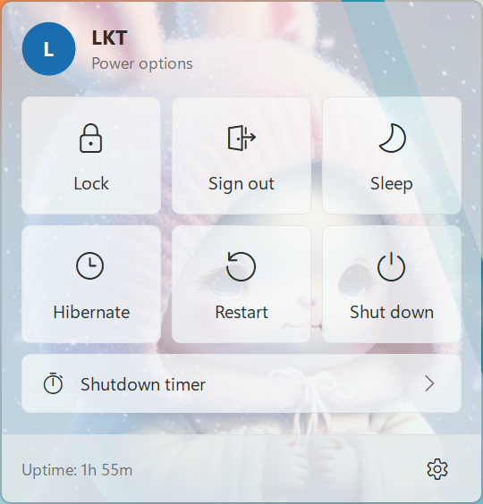
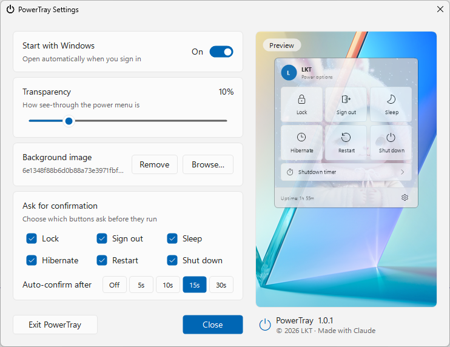

# PowerTray

Power options next to the Windows clock. Click the tray icon to lock, sign out, sleep, hibernate, restart or shut down your PC, or set a timer to shut it down later.

<p align="center">
  
</p>

## Features

- **One click to power options.** The menu looks like a Windows 11 flyout and opens just above the tray icon. It follows the light or dark theme and your accent color.
- **Lock, Sign out, Sleep, Hibernate, Restart, Shut down.** Hibernate only appears if your PC supports it.
- **Shutdown timer.** Pick a delay with the − / + buttons or a preset (15 min, 30 min, 1 hr, 2 hr). A dot appears on the tray icon while the timer runs, and the tooltip shows the time left. You get a warning 1 minute before shutdown, and you can cancel the timer from the menu or by right-clicking the icon.
- **Confirmation you control.** Choose which buttons ask before they run. You can also make a confirmation go ahead by itself after 5, 10, 15 or 30 seconds.
- **Make it yours.** Set the menu's transparency (up to 50%) and add your own background image.
- **Start with Windows.** Turn this on to have PowerTray run when you sign in.

## Settings

Right-click the tray icon and choose **Settings…**, or click the gear in the menu. The preview on the right updates as you make changes.



## Install

> [!IMPORTANT]
> PowerTray needs the **.NET 8 Desktop Runtime** (or newer).
>
> **[⬇ Download .NET 8 Desktop Runtime (Windows x64)](https://aka.ms/dotnet/8.0/windowsdesktop-runtime-win-x64.exe)** · [All .NET 8 downloads](https://dotnet.microsoft.com/download/dotnet/8.0)

1. Install the [.NET 8 Desktop Runtime](https://aka.ms/dotnet/8.0/windowsdesktop-runtime-win-x64.exe) if you don't have it. The PowerTray installer also reminds you if it's missing.
2. Download `PowerTraySetup-<version>.exe` from the [latest release](https://github.com/lkt-th/PowerTray/releases/latest) and run it. It installs for your user only into `%LOCALAPPDATA%\Programs\PowerTray`, so it doesn't need admin rights.

PowerTray needs Windows 10 (version 1809) or later.

## Usage

| Action | Result |
| --- | --- |
| Left-click the tray icon | Open or close the power menu |
| Right-click the tray icon | Cancel the shutdown timer, open Settings, or exit |
| `Esc` | Go back, or close the menu |

Command-line options are useful for shortcuts:

```
PowerTray.exe --show       Open the power menu
PowerTray.exe --settings   Open Settings
```

Only one copy of PowerTray runs at a time.

## Build

Requires the [.NET 8 SDK](https://dotnet.microsoft.com/download/dotnet/8.0).

```powershell
dotnet run                    # run from source
.\build-installer.ps1         # build publish\PowerTray.exe and the installer
```

`build-installer.ps1` needs [Inno Setup 6](https://jrsoftware.org/isinfo.php). The installer is written to `installer\Output\`.

Settings are stored in `HKCU\Software\PowerTray`, and the background image is copied to `%LOCALAPPDATA%\PowerTray`.

## Credits

© 2026 LKT · Made with [Claude](https://claude.ai)
